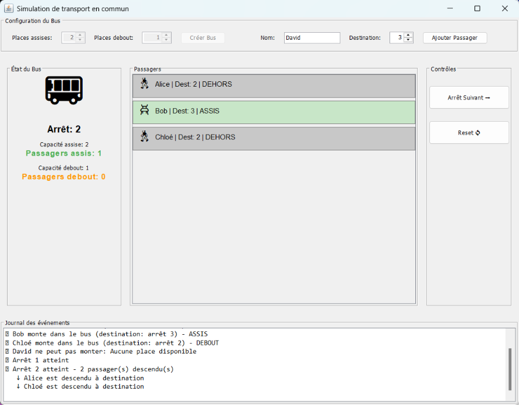
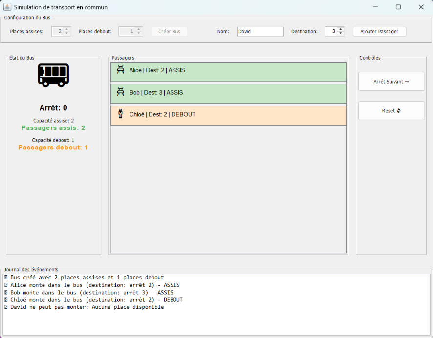

# Simulateur de transport en Java

Simulateur d’un autobus en Java : des passagers montent, occupent une place assise ou debout selon la capacité, puis descendent à leur arrêt de destination quand le bus avance.

**Java 17 · Swing · Maven (Maven Wrapper) · JUnit 4 · Mockito · JaCoCo**



## Fonctionnalités

- **Autobus à capacité fixe** : nombre de places assises et de places debout choisi à la création. Une capacité négative est refusée.
- **Montée des passagers** : chaque passager a un nom et un arrêt de destination. Il prend une place assise s’il en reste, sinon une place debout. Quand le bus est plein, la montée est refusée avec une exception (`UsagerInvalideException`).
- **Arrêts numérotés** : le bus avance d’un arrêt à la fois (0, 1, 2…). À chaque arrêt, les passagers dont c’est la destination descendent et libèrent leur place.
- **États d’un passager** : dehors, assis ou debout, avec des transitions contrôlées (par exemple, un passager déjà dehors ne peut pas sortir).
- **Jauges d’occupation** (`JaugeNaturel`) pour les places assises et debout.
- **Fabrique** (`TransportFactory`) pour créer autobus et passagers sans dépendre des classes concrètes.
- **Interface graphique Swing** : configuration du bus, ajout de passagers, bouton « Arrêt Suivant », réinitialisation, liste des passagers colorée selon leur état, et journal des événements.
- **Démonstration console** (`simple.SimpleEtendu`) : plusieurs scénarios commentés, de la montée à la descente.

## Prérequis

- Un **JDK 17 ou plus récent**. La compilation cible Java 17.
- **Maven n’a pas besoin d’être installé** : le Maven Wrapper (`mvnw`, `mvnw.cmd`) télécharge Maven 3.9.16 au premier lancement et vérifie son empreinte SHA-256. Ce premier lancement demande une connexion Internet.
- Un écran, pour l’interface graphique.

## Lancer le projet

Depuis le dossier qui contient `pom.xml` :

```powershell
# Windows (PowerShell)
.\mvnw.cmd clean verify                                   # compilation, tests, couverture, JAR
java -jar target\transport-simulation-1.0.0-SNAPSHOT.jar  # interface Swing
java -cp target\classes simple.SimpleEtendu               # démonstration console
```

```sh
# macOS / Linux
./mvnw clean verify
java -jar target/transport-simulation-1.0.0-SNAPSHOT.jar
java -cp target/classes simple.SimpleEtendu
```

Depuis un IDE, importer le dossier comme projet Maven, puis lancer `gui.TransportGUI` (interface) ou `simple.SimpleEtendu` (console).

## Exemple d’utilisation

Dans l’interface :

1. Régler **Places assises** sur 2 et **Places debout** sur 1, puis cliquer sur **Créer Bus**.
2. Ajouter des passagers :
   - « Alice », destination 2 : elle est assise ;
   - « Bob », destination 3 : il est assis ;
   - « Chloé », destination 2 : elle est debout, car il n’y a plus de place assise.
3. Ajouter « David » : le bus est plein, une fenêtre « Bus plein » s’affiche et il ne monte pas.
4. Cliquer sur **Arrêt Suivant** :
   - arrêt 1 : personne ne descend ;
   - arrêt 2 : Alice et Chloé descendent ;
   - arrêt 3 : Bob descend et le bus est vide.



Le même déroulement en code :

```java
Autobus bus = new Autobus(2, 1);
PassagerStandard alice = new PassagerStandard("Alice", 2);
alice.monterDans(bus);          // assise
bus.allerArretSuivant();        // arrêt 1
bus.allerArretSuivant();        // arrêt 2 : Alice descend
System.out.println(bus);        // [arret:2, assis:0, debout:0]
```

## Tests

```powershell
.\mvnw.cmd test      # tests seuls
.\mvnw.cmd verify    # tests + contrôle de couverture JaCoCo
```

150 tests JUnit 4, répartis en six classes :

| Classe | Tests | Contenu |
|---|---|---|
| `EtatPassagerTest` | 15 | États dehors / assis / debout |
| `JaugeNaturelTest` | 23 | Jauges d’occupation, bornes |
| `AutobusTestMockito` | 28 | Autobus, passagers simulés avec Mockito |
| `PassagerStandardTestMockito` | 29 | Passager, bus simulé avec Mockito |
| `TestsFonctionnels` | 16 | Scénarios complets avec de vrais objets |
| `CouvertureBranchesTest` | 39 | Cas limites et chemins d’erreur |

Le rapport de couverture est généré dans `target/site/jacoco/index.html`. Le build échoue sous 99 % de lignes ou de branches couvertes. Le périmètre est le modèle `tec` ; l’interface (`gui`) et la démonstration (`simple`) en sont exclues. Mesure actuelle : 171 lignes sur 172 et 101 branches sur 102.

L’intégration continue (GitHub Actions, `.github/workflows/java.yml`) lance `./mvnw clean verify` puis la démonstration console, sur Java 17 et 21.

## Organisation

```text
src/main/java/tec/      Modèle : Autobus, PassagerStandard, états, jauges, fabrique, interfaces
src/main/java/gui/      Interface Swing (TransportGUI)
src/main/java/simple/   Démonstration console (SimpleEtendu)
src/test/java/tec/      Tests JUnit 4 et Mockito
docs/captures/          Captures de l’interface
```

Le modèle repose sur des interfaces (`Transport`, `Bus`, `Usager`, `Passager`) et sur un double dispatch. Le passager demande une place au bus, le bus lui attribue un état, et à chaque arrêt le bus prévient ses passagers, qui demandent à sortir s’ils sont arrivés. L’interface graphique utilise ce modèle sans le modifier.

## Limites connues

- Un seul bus et un seul type de passager (`PassagerStandard`). Les arrêts sont de simples numéros, sans nom ni ligne.
- Le bus avance sans fin : il n’y a ni terminus ni itinéraire.
- Un passager debout ne s’assoit pas quand une place se libère. Le modèle prévoit les changements de place, mais ce comportement n’est pas implémenté.
- Pas de sauvegarde : une simulation est perdue à la fermeture.
- Dans le journal de l’interface, les symboles « ✓ » et « ➡ » s’affichent comme des carrés sous Windows, car la police Consolas n’a pas ces caractères.
- Le texte des messages n’accorde pas le participe au féminin (« Alice est descendu à destination »).
- L’interface n’a pas de tests automatisés dans le projet. Elle a été vérifiée par un scénario manuel automatisé (voir ci-dessous).

## État de validation

Vérifié le 8 octobre 2026 sous Windows 11, avec le JDK 24.0.1 et Maven 3.9.16 via le wrapper :

- `.\mvnw.cmd clean verify` : 150 tests réussis, contrôle de couverture JaCoCo respecté, JAR construit ;
- démonstration console exécutée jusqu’à « TOUS LES SCÉNARIOS TERMINÉS AVEC SUCCÈS » ;
- interface lancée depuis le JAR et parcourue sur l’écran réel avec l’exemple ci-dessus : montées, refus « Bus plein », arrêts 1 à 3, descentes et réinitialisation. Les compteurs et le journal correspondent à chaque étape.

## Contexte et présentation

Projet pédagogique réalisé **en équipe de trois**, présenté dans le portfolio d’**Alae Ddine AFRAKLA**. Ce dépôt reprend la dernière partie du projet de cours, qui est la version complète, plutôt que les étapes intermédiaires.

La répartition des contributions individuelles n’est pas documentée dans l’archive reçue. La présence du projet sur un compte personnel ne signifie pas que son propriétaire en est l’unique auteur.

Différences avec la version rendue en cours :
- POM aligné sur Java 17, avec un JAR exécutable ;
- versions des outils de test mises à jour pour les JDK récents (Mockito 5.24.0, JaCoCo 0.8.15, plugins Maven) ;
- ajout du Maven Wrapper ;
- dans l’interface, le texte blanc des deux boutons, illisible sous Windows, a été retiré.

Aucune licence de redistribution n’est ajoutée : ce dépôt ne modifie pas les droits des auteurs ou des éventuels supports pédagogiques.
